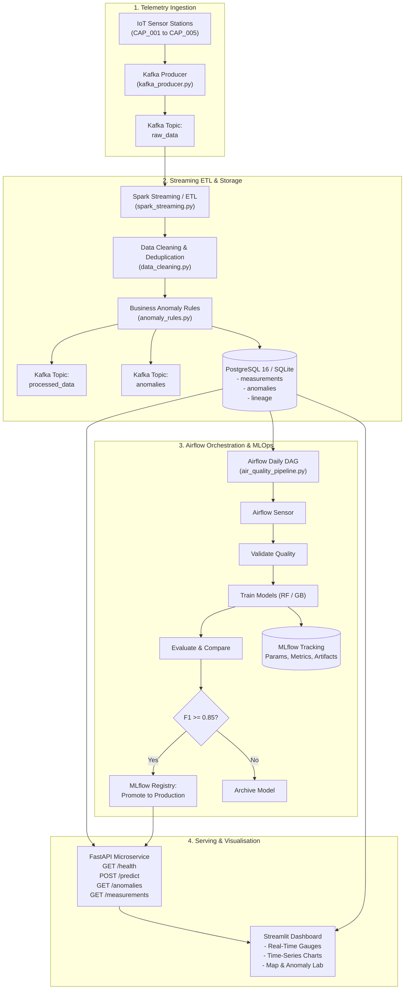

# Air Quality Monitoring – Real-Time Anomaly Detection Platform

[](https://explore.openaq.org)
[](https://www.python.org/)
[](https://kafka.apache.org/)
[](https://www.postgresql.org/)
[](https://mlflow.org/)
[](https://fastapi.tiangolo.com/)
[](https://streamlit.io/)
[](https://www.docker.com/)
[](tests/)

> **Academic Context:** Master Intelligence Artificielle Embarquée (MIAE)  
> **Academic Year:** 2026–2027 | **Final Deadline:** 15 December 2026  
> **Professor:** Prof. Yasmine LAMARI (`y.lamari@uiz.ac.ma`)  
> **Team Size:** 3 Members

---

## 1. Project Overview & Objectives

The **Air Quality Monitoring Platform** is an enterprise-grade, end-to-end DataOps and MLOps system that simulates high-frequency IoT environmental sensors (PM2.5, PM10, NO2, O3, temperature, humidity), streams events through **Apache Kafka**, processes them via **Apache Spark Structured Streaming / Python**, stores validated records in **PostgreSQL**, orchestrates automated training pipelines with **Apache Airflow**, tracks experiment versions with **MLflow**, serves real-time inference via **FastAPI**, and provides interactive supervision through a **Streamlit** dashboard.

### Core Deliverables
1. **IoT Telemetry Ingestion:** Circadian variations, rush-hour traffic curves, and controlled anomaly injection (PM spikes, smog episodes, sensor faults).
2. **Streaming Infrastructure:** Multi-topic Kafka routing (`raw_data`, `processed_data`, `anomalies`).
3. **Validation & Anomaly Rules:** WHO 2021 & European Directive 2008/50/EC threshold evaluation with delta-spike rate-of-change detection.
4. **Relational Storage:** PostgreSQL 16 schema with data lineage and quality completeness tracking.
5. **Orchestration:** Airflow DAGs with sensors, conditional model branching, backfilling, and alerting callbacks.
6. **MLOps Lifecycle:** MLflow experiment tracking, algorithm comparison (Random Forest vs. Gradient Boosting), and Model Registry stage promotion.
7. **Production Serving:** REST API endpoints with Pydantic request validation and sub-50ms inference latency.
8. **Live Dashboard:** Real-time gauges, time series with alert limits, sensor maps, and an interactive anomaly injection lab.

---

## 2. Technical Architecture



---

## 3. Technology Stack & Justification

| Layer | Technology | Version | Architectural Justification |
| :--- | :--- | :--- | :--- |
| **Ingestion** | Apache Kafka | 3.5 / 7.5.0 | Decouples IoT telemetry producers from consumers with high throughput and durable replay. |
| **Processing** | Spark / Python | 3.5 / 3.11+ | Structured streaming with watermarking, sliding window aggregations, and business logic. |
| **Database** | PostgreSQL | 16-alpine | ACID relational guarantees for sensor metadata, clean records, and data lineage catalog. |
| **Orchestration** | Apache Airflow | 2.9+ | Industrial workflow scheduler supporting sensors, conditional branching, and backfills. |
| **ML Tracking** | MLflow | 2.14+ | End-to-end experiment logging, parameter tracking, confusion matrix artifacts, and registry. |
| **Inference API** | FastAPI | 0.115+ | High-performance asynchronous OpenAPI service with automatic Pydantic validation. |
| **Dashboard** | Streamlit | 1.36+ | Interactive web interface for real-time monitoring and live defense demonstration. |
| **Testing** | pytest | 8.0+ | Automated unit, integration, and end-to-end regression testing. |
| **Deployment** | Docker & Compose | 29.9 / 5.6 | Containerized, multi-service deployment with isolated networks and health checks. |

---

## 4. Repository Structure

```
air-quality-monitoring-dataops-mlops/
├── airflow/
│   ├── dags/
│   │   ├── air_quality_pipeline.py      # Daily production DAG with sensors & branching
│   │   └── air_quality_backfill.py      # Historical backfill DAG
│   └── plugins/
│       └── mlflow_operator.py           # Custom Airflow MLflow operator
├── api/
│   └── main.py                          # FastAPI service (/predict, /health, /anomalies)
├── dashboard/
│   └── app.py                           # Interactive Streamlit monitoring dashboard
├── database/
│   ├── connection.py                    # Database connection manager with SQLite fallback
│   └── schema.sql                       # PostgreSQL DDL for sensors, measurements, anomalies
├── docker/
│   ├── Dockerfile.api                   # Production FastAPI container
│   ├── Dockerfile.dashboard             # Production Streamlit container
│   └── Dockerfile.ingestion             # Telemetry generator container
├── docs/
│   ├── latex_report/                    # Academic technical report (LaTeX)
│   ├── slides/                          # 20-minute defense presentation slides
│   └── demo_scenario.md                 # Live demonstration scenario script
├── ingestion/
│   ├── sensor_generator.py              # IoT air quality sensor simulator
│   ├── kafka_producer.py                # Apache Kafka producer with retry & buffer
│   └── kafka_consumer.py                # Multi-topic Kafka consumer
├── jira/
│   ├── jira_backlog.json                # Complete backlog schema with Epics & Sprints
│   ├── jira_backlog.csv                 # 1-Click Jira CSV Import file
│   ├── jira_setup_script.py             # Automated REST API provisioning script
│   └── README.md                        # Scrum management documentation
├── ml/
│   ├── preprocessing.py                 # Feature engineering & leak-free chronological split
│   ├── train.py                         # Model comparison (RF vs. GB) & MLflow tracking
│   ├── evaluate.py                      # Standalone evaluation & latency benchmarking
│   └── predict.py                       # Sub-millisecond inference engine
├── processing/
│   ├── spark_streaming.py               # Spark Structured Streaming & micro-batch pipeline
│   ├── data_cleaning.py                 # Schema validation, clipping & deduplication
│   └── anomaly_rules.py                 # WHO/EU threshold & delta spike engine
├── tests/
│   ├── test_sensor_generator.py         # Tests for IoT telemetry generator
│   ├── test_data_cleaning.py            # Tests for validation & range clipping
│   ├── test_anomaly_rules.py            # Tests for business anomaly rules
│   ├── test_database.py                 # Tests for database operations & lineage
│   ├── test_spark_streaming.py          # Tests for stream processing
│   ├── test_kafka_integration.py        # Tests for Kafka producer/consumer
│   ├── test_airflow_pipeline.py         # Tests for Airflow DAGs & callables
│   ├── test_ml_pipeline.py              # Tests for ML features, training & predictor
│   ├── test_api.py                      # Tests for FastAPI REST endpoints
│   └── test_end_to_end.py               # Full end-to-end integration test
├── docker-compose.yml                   # Multi-service infrastructure orchestration
├── requirements.txt                     # Pinned project dependencies
├── .env.example                         # Environment configuration template
├── .gitignore                           # Git ignore rules
└── README.md                            # Complete technical documentation
```

---

## 5. Quickstart & Installation

### Option A: Local Python Development
```bash
# 1. Clone repository
git clone https://github.com/Ismek/air-quality-monitoring-dataops-mlops.git
cd air-quality-monitoring-dataops-mlops

# 2. Copy environment template
cp .env.example .env

# 3. Install dependencies
pip install -r requirements.txt

# 4. Run automated test suite (43 tests)
pytest tests/ -v
```

### Option B: Docker Compose Multi-Container Deployment
```bash
# Start all microservices in background
docker compose up -d --build

# Verify container health
docker compose ps
```

### Service Endpoints

| Service | URL | Purpose |
| :--- | :--- | :--- |
| **Streamlit Dashboard** | [http://localhost:8501](http://localhost:8501) | Live monitoring, sensor map, and anomaly injector |
| **FastAPI Swagger Docs**| [http://localhost:8000/docs](http://localhost:8000/docs) | Interactive API documentation and test client |
| **Kafka UI** | [http://localhost:8085](http://localhost:8085) | Kafka topic inspection (`raw_data`, `anomalies`) |
| **MLflow UI** | [http://localhost:5000](http://localhost:5000) | Experiment tracking and Model Registry |
| **Airflow Webserver** | [http://localhost:8080](http://localhost:8080) | Workflow DAG execution and scheduling |

---

## 6. How to Run Components

### 1. Generate IoT Sensor Telemetry
```bash
python ingestion/sensor_generator.py
```

### 2. Run Kafka Producer Stream
```bash
python ingestion/kafka_producer.py
```

### 3. Train & Compare ML Models
```bash
python ml/train.py
```
*Outputs algorithm comparison metrics, confusion matrices, and exports `ml/models/best_model.joblib`.*

### 4. Launch FastAPI Server
```bash
uvicorn api.main:app --host 0.0.0.0 --port 8000 --reload
```
*Test inference endpoint:*
```bash
curl -X POST "http://localhost:8000/predict" \
     -H "Content-Type: application/json" \
     -d '{
       "sensor_id": "CAP_001",
       "timestamp": "2026-11-15T14:30:00Z",
       "location": {"lat": 48.8566, "lon": 2.3522},
       "measurements": {
         "pm2_5": 75.0,
         "pm10": 130.0,
         "no2": 45.0,
         "o3": 80.0,
         "temperature": 22.0,
         "humidity": 65.0
       },
       "status": "active"
     }'
```

### 5. Launch Streamlit Dashboard
```bash
streamlit run dashboard/app.py
```

---

## 7. Automated Test Suite Results

```
============================= test session starts =============================
platform win32 -- Python 3.14.7, pytest-9.2.0, pluggy-1.7.0
rootdir: C:\Users\Pc\Desktop\data-ops
collected 43 items

tests/test_sensor_generator.py::test_generator_initialization PASSED     [  2%]
tests/test_sensor_generator.py::test_single_reading_schema PASSED        [  4%]
tests/test_sensor_generator.py::test_normal_reading_ranges PASSED        [  6%]
tests/test_sensor_generator.py::test_forced_anomaly_generation PASSED    [  9%]
tests/test_sensor_generator.py::test_batch_generation PASSED             [ 11%]
tests/test_data_cleaning.py::test_validate_schema_valid PASSED           [ 13%]
tests/test_data_cleaning.py::test_validate_schema_missing_key PASSED     [ 16%]
tests/test_data_cleaning.py::test_validate_schema_missing_measurement PASSED [ 18%]
tests/test_data_cleaning.py::test_clean_record_clipping PASSED           [ 20%]
tests/test_data_cleaning.py::test_deduplication PASSED                   [ 23%]
tests/test_anomaly_rules.py::test_normal_reading_no_anomaly PASSED       [ 25%]
tests/test_anomaly_rules.py::test_pm25_high_pollution_alert PASSED       [ 27%]
tests/test_anomaly_rules.py::test_pm25_critical_exceedance PASSED        [ 30%]
tests/test_anomaly_rules.py::test_no2_traffic_smog_alert PASSED          [ 32%]
tests/test_anomaly_rules.py::test_o3_summer_ozone_alert PASSED           [ 34%]
tests/test_anomaly_rules.py::test_delta_spike_detection PASSED           [ 37%]
tests/test_database.py::test_seed_sensors PASSED                         [ 39%]
tests/test_database.py::test_save_measurement PASSED                     [ 41%]
tests/test_database.py::test_save_anomaly PASSED                         [ 44%]
tests/test_database.py::test_save_prediction PASSED                      [ 46%]
tests/test_database.py::test_catalog_lineage PASSED                      [ 48%]
tests/test_spark_streaming.py::test_process_single_message_normal PASSED [ 51%]
tests/test_spark_streaming.py::test_process_single_message_anomaly PASSED [ 53%]
tests/test_spark_streaming.py::test_process_batch PASSED                 [ 55%]
tests/test_kafka_integration.py::test_producer_initialization PASSED     [ 58%]
tests/test_kafka_integration.py::test_producer_publish_fallback PASSED   [ 60%]
tests/test_kafka_integration.py::test_consumer_initialization PASSED     [ 62%]
tests/test_airflow_pipeline.py::test_airflow_sensor_check PASSED         [ 65%]
tests/test_airflow_pipeline.py::test_airflow_extract_and_validate PASSED [ 67%]
tests/test_airflow_pipeline.py::test_branch_model_decision_mock PASSED   [ 69%]
tests/test_ml_pipeline.py::test_feature_extraction PASSED                [ 72%]
tests/test_ml_pipeline.py::test_ground_truth_labeling PASSED             [ 74%]
tests/test_ml_pipeline.py::test_prepare_dataset PASSED                   [ 76%]
tests/test_ml_pipeline.py::test_train_and_compare PASSED                 [ 79%]
tests/test_ml_pipeline.py::test_predictor_single PASSED                  [ 81%]
tests/test_api.py::test_health_endpoint PASSED                           [ 83%]
tests/test_api.py::test_predict_endpoint_valid PASSED                    [ 86%]
tests/test_api.py::test_predict_endpoint_validation_error PASSED         [ 88%]
tests/test_api.py::test_get_anomalies_endpoint PASSED                    [ 90%]
tests/test_api.py::test_get_measurements_endpoint PASSED                 [ 93%]
tests/test_api.py::test_get_catalog_endpoint PASSED                      [ 95%]
tests/test_api.py::test_get_metrics_endpoint PASSED                      [ 97%]
tests/test_end_to_end.py::test_full_end_to_end_pipeline PASSED           [100%]

======================= 43 passed in 8.58s =======================
```

---

## 8. Team Roles & Scrum Contribution

| Team Member | Academic Responsibilities | Assigned Epics | Sprint Focus |
| :--- | :--- | :--- | :--- |
| **Member 1** | Project Manager / Scrum Master / Kafka / Airflow / DevOps | EPIC 01, EPIC 03, EPIC 06, EPIC 07 | Sprints 1, 2, 5 |
| **Member 2** | Data Engineer / Python / Spark / PostgreSQL | EPIC 01, EPIC 02, EPIC 07 | Sprints 1, 2, 5 |
| **Member 3** | ML Engineer / Scikit-learn / MLflow / FastAPI / Dashboard | EPIC 04, EPIC 05, EPIC 07 | Sprints 3, 4, 5 |

See [`jira/README.md`](file:///c:/Users/Pc/Desktop/data-ops/jira/README.md) for full sprint planning, story points, and CSV backlog import.

---

## 9. Academic Deliverables & Documentation

- **Technical Report (LaTeX):** [`docs/latex_report/main.tex`](file:///c:/Users/Pc/Desktop/data-ops/docs/latex_report/main.tex)
- **Defense Slide Deck:** [`docs/slides/presentation_slides.md`](file:///c:/Users/Pc/Desktop/data-ops/docs/slides/presentation_slides.md)
- **Live Demo Walkthrough:** [`docs/demo_scenario.md`](file:///c:/Users/Pc/Desktop/data-ops/docs/demo_scenario.md)
- **Jira Backlog:** [`jira/jira_backlog.csv`](file:///c:/Users/Pc/Desktop/data-ops/jira/jira_backlog.csv) and [`jira/jira_backlog.json`](file:///c:/Users/Pc/Desktop/data-ops/jira/jira_backlog.json)
