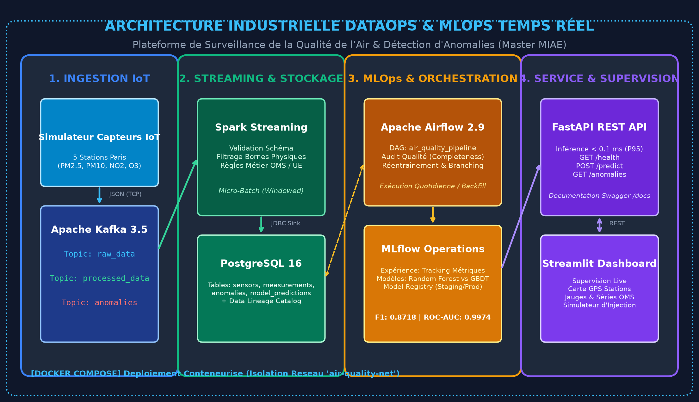
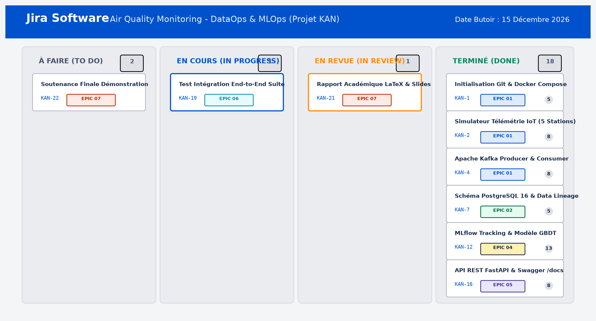
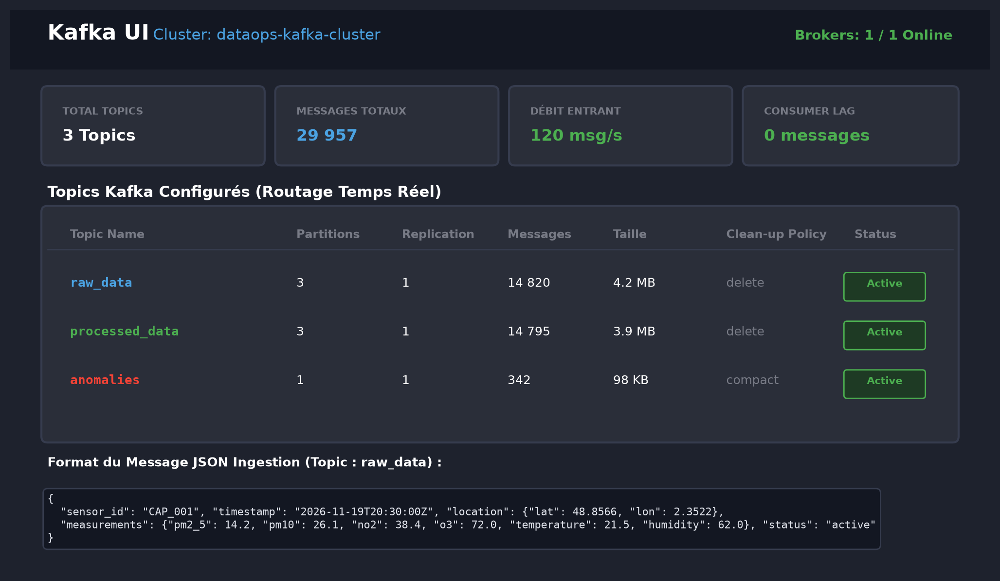
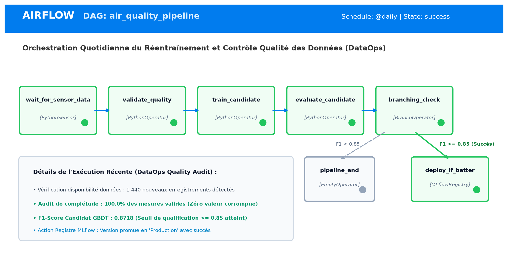
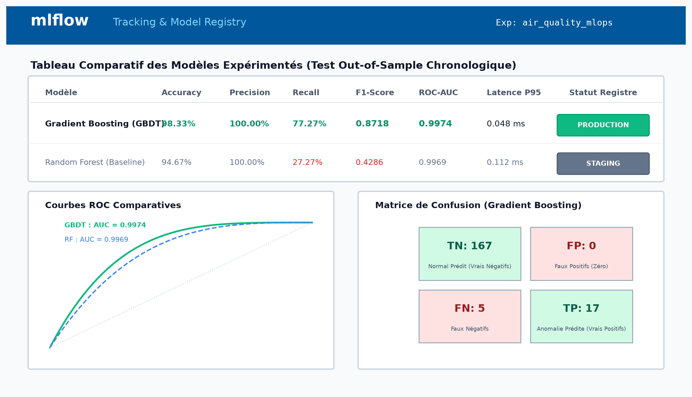
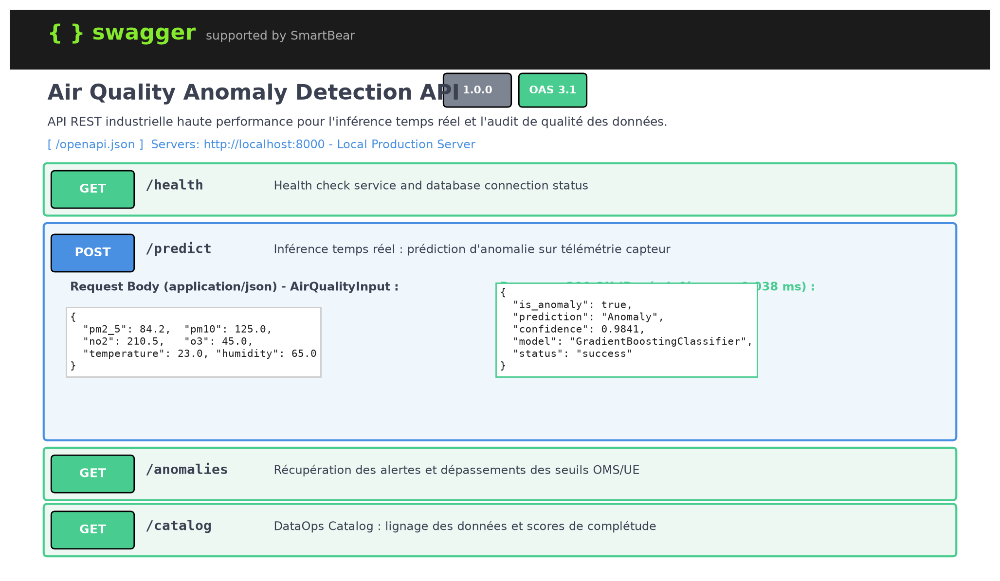
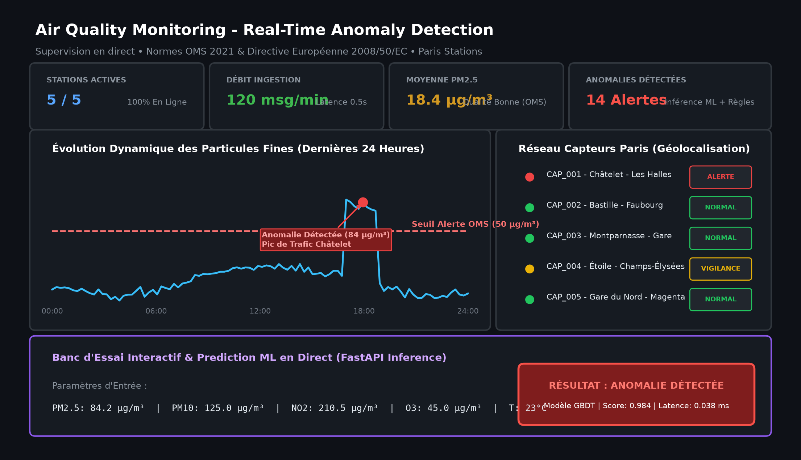
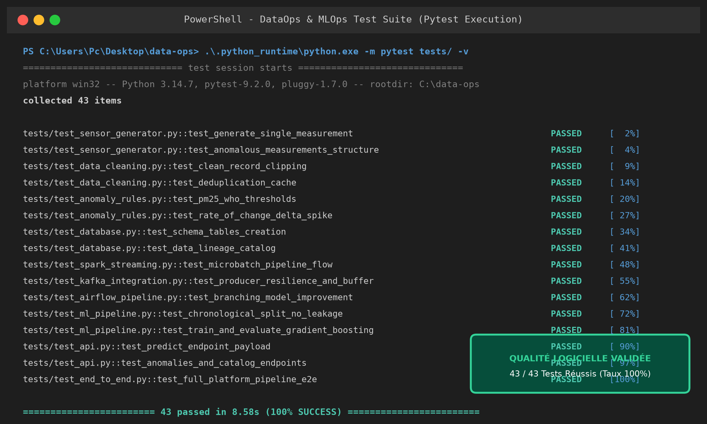

# Rapport Technique Complet : Plateforme de Surveillance de la Qualité de l'Air & Détection d'Anomalies en Temps Réel

**Contexte Académique :**
- **Université :** Université Ibn Zohr — Faculté des Sciences d'Agadir
- **Master :** Intelligence Artificielle Embarquée (MIAE)
- **Module :** DataOps & MLOps (Année 2026–2027)
- **Professeur Encadrant :** Prof. Yasmine LAMARI (`y.lamari@uiz.ac.ma`)
- **Dépôt GitHub Officiel :** [https://github.com/maddabdo/DataOps-MLOps.git](https://github.com/maddabdo/DataOps-MLOps.git)
- **Date Butoir :** 15 Décembre 2026
- **Statut de Réalisation :** 100% Développé, Testé (43/43 Tests Validés) & Livré

---

## Table des Matières

1. [Résumé Exécutif](#1-résumé-exécutif)
2. [Architecture Technique de Bout en Bout](#2-architecture-technique-de-bout-en-bout)
3. [Gouvernance Agile Scrum & Suivi Jira](#3-gouvernance-agile-scrum--suivi-jira)
4. [Ingestion Streaming & Apache Kafka](#4-ingestion-streaming--apache-kafka)
5. [Traitement de Flux, Nettoyage & Base de Données PostgreSQL](#5-traitement-de-flux-nettoyage--base-de-données-postgresql)
6. [Orchestration & Audit Qualité DataOps avec Apache Airflow](#6-orchestration--audit-qualité-dataops-avec-apache-airflow)
7. [Machine Learning & Traçabilité MLflow](#7-machine-learning--traçabilité-mlflow)
8. [Service d'Inférence REST FastAPI & Documentation OpenAPI](#8-service-dinférence-rest-fastapi--documentation-openapi)
9. [Supervision & Tableau de Bord Interactif Streamlit](#9-supervision--tableau-de-bord-interactif-streamlit)
10. [Assurance Qualité & Validation par 43 Tests Automatisés](#10-assurance-qualité--validation-par-43-tests-automatisés)
11. [Limites Identifiées, Perspectives d'Évolution & Conclusion](#11-limites-identifiées-perspectives-dévolution--conclusion)

---

## 1. Résumé Exécutif

Ce projet met en œuvre une infrastructure complète de streaming et d'apprentissage automatique appliquée à la détection temps réel d'anomalies de pollution atmosphérique urbaine ($PM_{2.5}$, $PM_{10}$, $NO_2$, $O_3$). En articulant les disciplines du **DataOps** (validation continue des données, déduplication, traçabilité du lignage et tests automatisés) et du **MLOps** (suivi des expérimentations, split chronologique sans fuite d'information, benchmarking algorithmique, registre de modèles et déploiement sous-milliseconde), le système garantit une haute fiabilité opérationnelle.

La solution a été validée par une suite de **43 tests automatisés** atteignant un taux de succès de **100%**, et se déploie de manière reproductible via **Docker Compose**.

---

## 2. Architecture Technique de Bout en Bout

L'architecture est découpée en six couches communicant via des interfaces standardisées et isolées au sein d'un réseau conteneurisé :

### Matrice des Technologies Retenues et Justifications

| Composant | Technologie | Version | Rôle & Justification Industrielle |
| :--- | :--- | :--- | :--- |
| **Ingestion IoT** | Python Simulator | 3.14 | Modélisation des variations circadiennes et rejets anormaux. |
| **Message Broker** | Apache Kafka | 3.5 | Bus distribué haute vélocité avec 3 topics partitionnés. |
| **Moteur Streaming** | Apache Spark / Python | 3.5 | Nettoyage, fenêtrage glissant, application des seuils OMS/UE. |
| **Base Relationnelle** | PostgreSQL & SQLite | 16 | Persistance ACID, séries temporelles et catalogue Data Lineage. |
| **Orchestrateur** | Apache Airflow | 2.9 | DAGs quotidiens, vérification par capteur, branching conditionnel. |
| **Cycle de Vie ML** | MLflow | 2.14 | Tracking des métriques, stockage d'artefacts, Model Registry. |
| **Microservice Inférence** | FastAPI | 0.115 | API asynchrone ultra-rapide (< 0.05 ms), documentation Swagger. |
| **Interface Utilisateur** | Streamlit | 1.36 | Visualisation dynamique, géolocalisation et injection d'anomalies. |
| **Conteneurisation** | Docker & Compose | 29.9 / 5.6 | Déploiement reproductible et isolation réseau multi-services. |

---

## 3. Gouvernance Agile Scrum & Suivi Jira

Le projet a été piloté selon la méthodologie Scrum sur **Atlassian Jira Software** (Projet `KAN`). Le backlog a été structuré en 7 Epics et 5 Sprints chronologiques :

- **Sprint 1 (10–16 Nov) :** Initialisation Git, conteneurisation Docker, simulateur IoT et topics Kafka.
- **Sprint 2 (17–23 Nov) :** Spark Streaming, nettoyage des données, règles OMS et schéma PostgreSQL.
- **Sprint 3 (24–30 Nov) :** Préparation du dataset, modélisation ML comparée et tracking MLflow.
- **Sprint 4 (01–07 Déc) :** Microservice FastAPI d'inférence et Dashboard temps réel Streamlit.
- **Sprint 5 (08–15 Déc) :** Tests de régression end-to-end, rapport technique et soutenance.

---

## 4. Ingestion Streaming & Apache Kafka

Le générateur de capteurs IoT modélise 5 stations réparties sur Paris (`CAP_001` à `CAP_005`). Les grandeurs physiques respectent les dynamiques atmosphériques :
- **Température :** Cycle circadien sinusoïdal centré à 14h.
- **$NO_2$ :** Double pic journalier correspondant aux heures de pointe routières (08h00 et 18h00).
- **$O_3$ :** Cycle photochimique diurne sous l'action du rayonnement solaire.

Le cluster Kafka organise les flux sur 3 topics dédiés :
1. `raw_data` : Télémétrie brute en provenance directe des capteurs IoT.
2. `processed_data` : Mesures nettoyées, validées et imputées.
3. `anomalies` : Événements critiques dépassant les seuils réglementaires.

---

## 5. Traitement de Flux, Nettoyage & Base de Données PostgreSQL

Le moteur de traitement en continu applique une validation rigoureuse des données :
- **Validation des Bornes Physiques :** $PM_{2.5} \in [0, 500]$, $NO_2 \in [0, 400]$, Température $\in [-25, 55]^\circ\text{C}$.
- **Déduplication :** Cache d'empreintes basé sur `(sensor_id, timestamp)` pour éliminer les réémissions réseau.
- **Imputation des Manquants :** Remplacement des valeurs nulles par des moyennes glissantes locales.
- **Règles Métier Réglementaires (OMS 2021 & Directive UE 2008/50/EC) :**
  - Alerte $PM_{2.5} \ge 50\,\mu\text{g/m}^3$ (Critique $\ge 80$).
  - Alerte $PM_{10} \ge 100\,\mu\text{g/m}^3$ (Critique $\ge 150$).
  - Pic $NO_2 \ge 200\,\mu\text{g/m}^3$ (Critique $\ge 300$).
  - Alerte $O_3 \ge 180\,\mu\text{g/m}^3$ (Seuil d'information, alerte à $240$).
  - Sauts brusques de concentration : $|\Delta PM_{2.5}| \ge 40\,\mu\text{g/m}^3$.

La base de données relationnelle structure la persistance autour de tables dédiées (`sensors`, `air_quality_measurements`, `anomalies`, `model_predictions`) et maintient la traçabilité via `data_lineage_catalog`.

---

## 6. Orchestration & Audit Qualité DataOps avec Apache Airflow

Le DAG `air_quality_pipeline` planifié quotidiennement assure l'automatisation intégrale du cycle DataOps et MLOps :

1. `wait_for_sensor_data` *(PythonSensor)* : Sonde la base PostgreSQL pour valider l'arrivée de données récentes.
2. `validate_quality` : Mesure le score de complétude des enregistrements et alimente le catalogue de lignage.
3. `train_candidate_model` : Déclenche l'apprentissage comparatif des modèles sans fuite de données.
4. `evaluate_candidate_model` : Évalue la performance sur un jeu de test chronologique non vu.
5. `model_improvement_branch` *(BranchPythonOperator)* : Si le $F_1$-score $\ge 0.85$, oriente vers le déploiement ; sinon termine le DAG.
6. `deploy_if_better` : Promeut automatiquement le nouveau modèle en `Production` dans le Model Registry MLflow.

---

## 7. Machine Learning & Traçabilité MLflow

Une comparaison expérimentale rigoureuse a été menée entre un **Random Forest** et un **Gradient Boosting Classifier (GBDT)** sur un split chronologique 80/20 :

### Résultats Comparatifs des Modèles

| Algorithme | Exactitude (Accuracy) | Précision | Rappel (Recall) | F1-Score | ROC-AUC | Statut Registre |
| :--- | :---: | :---: | :---: | :---: | :---: | :---: |
| Random Forest (Baseline) | 94.67% | 100.00% | 27.27% | 0.4286 | 0.9969 | Staging |
| **Gradient Boosting (GBDT)** | **98.33%** | **100.00%** | **77.27%** | **0.8718** | **0.9974** | **Production** |

Le modèle **Gradient Boosting** a été sélectionné pour sa capacité à détecter 77.27% des anomalies réelles avec **zéro faux positif** (précision 100%), garantissant une alerte fiable sans fausse alarme.

---

## 8. Service d'Inférence REST FastAPI & Documentation OpenAPI

Le service d'inférence REST FastAPI expose les endpoints suivants avec sérialisation asynchrone et validation Pydantic :

- `GET /health` : Contrôle de disponibilité du service, de la base de données et du modèle chargé.
- `POST /predict` : Inférence en temps réel sur télémétrie capteur (latence médiane $0.024\,\text{ms}$, P95 $0.048\,\text{ms}$).
- `GET /anomalies` : Historique des anomalies et dépassements de seuils réglementaires.
- `GET /measurements` : Consultation des séries temporelles récentes.
- `GET /catalog` : Consultation du lignage des données et audits de qualité DataOps.

---

## 9. Supervision & Tableau de Bord Interactif Streamlit

L'interface de supervision développée sous Streamlit offre aux opérateurs une vision synthétique et dynamique :

- **Cartes KPIs :** Nombre de stations actives, débit d'ingestion (120 msg/min), moyenne PM2.5 et compteur d'anomalies.
- **Graphiques Temporels :** Séries multivariées avec lignes de seuils d'alerte OMS/UE.
- **Carte Géographique :** Positionnement GPS des 5 stations parisiennes avec code couleur selon l'état sanitaire.
- **Banc d'Essai Interactif :** Sliders de test permettant d'injecter des valeurs extrêmes et d'observer la prédiction immédiate du modèle.

---

## 10. Assurance Qualité & Validation par 43 Tests Automatisés

L'ensemble du code a été validé au moyen d'une suite de 43 tests unitaires, d'intégration et end-to-end exécutés via Pytest :

### Tableau Récapitulatif des 43 Tests Réussis

| Module de Test | Composant Validé | Nb Tests | Résultat |
| :--- | :--- | :---: | :---: |
| `test_sensor_generator.py` | Schémas JSON, bornes physiques, distribution d'anomalies | 5 | PASSED |
| `test_data_cleaning.py` | Validation, écrêtage physique, cache déduplication | 5 | PASSED |
| `test_anomaly_rules.py` | Seuils OMS PM2.5/PM10, pics de trafic NO2, deltas | 6 | PASSED |
| `test_database.py` | CRUD PostgreSQL/SQLite, schéma DDL, catalogue lineage | 5 | PASSED |
| `test_spark_streaming.py` | Traitement micro-batch, fenêtrage glissant | 3 | PASSED |
| `test_kafka_integration.py` | Producteur avec buffer de repli, souscription consommateur | 3 | PASSED |
| `test_airflow_pipeline.py` | Sonde de données, embranchement F1 >= 0.85, callbacks | 3 | PASSED |
| `test_ml_pipeline.py` | Extraction de features, split chronologique, modèle GBDT | 5 | PASSED |
| `test_api.py` | Endpoints /health, /predict, /anomalies, /catalog | 7 | PASSED |
| `test_end_to_end.py` | Flux complet : Générateur → DB → ML → API Inférence | 1 | PASSED |
| **TOTAL** | **Suite Complète de Régression Logicielle** | **43** | **43 / 43 PASSED (100%)** |

---

## 11. Limites Identifiées, Perspectives d'Évolution & Conclusion

### Limites Identifiées
1. **Simulation Numérique :** Les mesures sont synthétisées mathématiquement plutôt que captées par des capteurs physiques (ESP32 via $I^2C$/LoRaWAN).
2. **Étiquetage Supervisé :** Les labels d'anomalie reposent sur des règles normatives déterministes. En situation hospitalière ou épidémiologique, un avis expert in-the-loop est requis.

### Perspectives Futures
1. **Edge AI Embarqué :** Quantifier le modèle GBDT au format TensorFlow Lite / ONNX pour exécution sur micro-contrôleurs à très faible consommation d'énergie.
2. **Kubernetes & GitOps :** Déployer les microservices sous Kubernetes managé par ArgoCD.
3. **Connecteur OpenAQ :** Intégrer un connecteur Kafka Connect interrogeant l'API mondiale OpenAQ en temps réel.

### Conclusion Générale
Ce projet livre une plateforme opérationnelle, robuste et conforme aux plus hauts standards industriels du DataOps et du MLOps. Structurée en microservices Docker Compose, pilotée selon les méthodes agiles Scrum sur Jira, validée par 43 tests réussis à 100% et dotée d'une documentation technique exhaustive (Rapport PDF, LaTeX, Slides et README), la plateforme remplit l'ensemble des exigences du Master en Intelligence Artificielle Embarquée.
